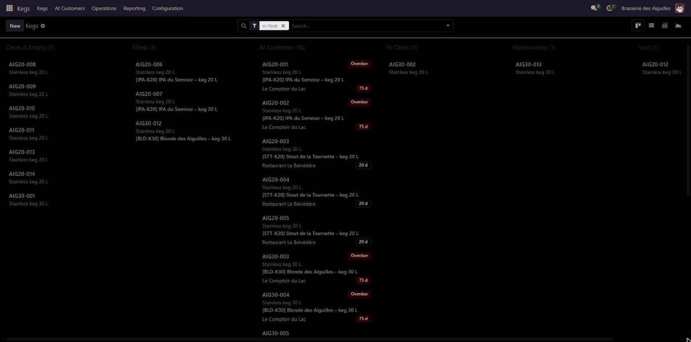
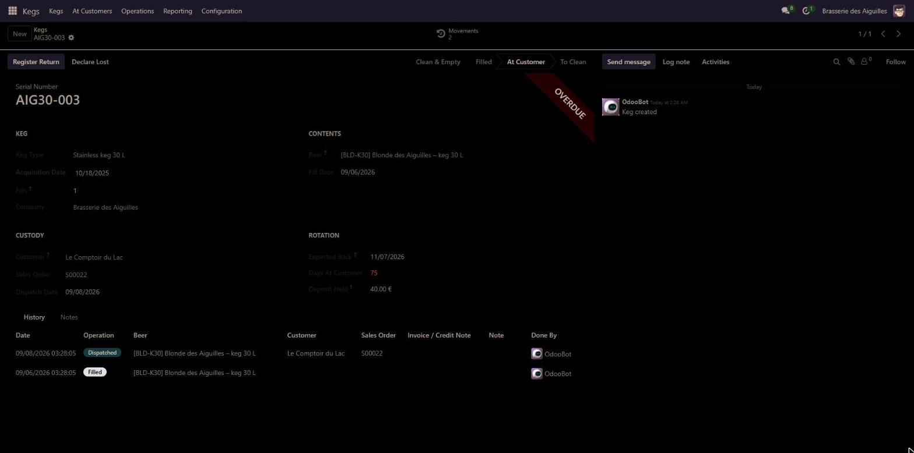
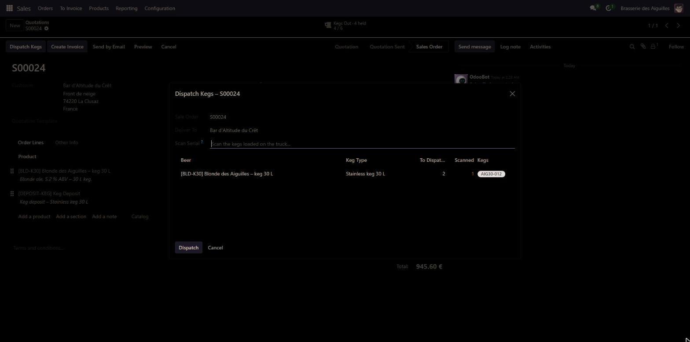
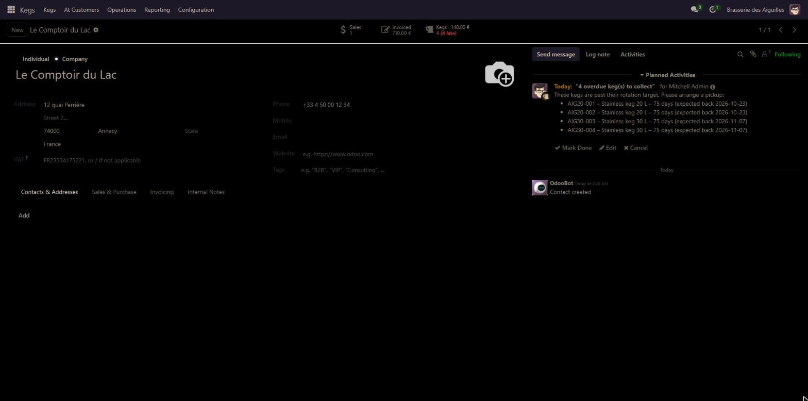

# Returnable Keg Tracking for Odoo 18

**A custom Odoo module for craft breweries and beverage distributors.** It tracks every keg by serial
number from the washing line to the customer and back. It also charges and refunds deposits exactly,
reminds sales reps about kegs sitting idle at customers, and bills customers for kegs they lose.

- **Odoo version:** 18.0 Community
- **`keg_tracking`:** core module, depends only on `sale_management`
- **`keg_tracking_stock`:** optional bridge, installed automatically when the Inventory app is present
- **Tests:** 25 automated tests
- **Author:** Cyril Gainon · License LGPL-3

| Keg fleet by status | Keg record: custody, rotation, history |
|---|---|
|  |  |
| **Scanning kegs onto a sales order** | **Overdue kegs: reminder on the customer** |
|  |  |

---

## 1. The business problem

A small brewery owns hundreds of stainless kegs worth €100–180 each. They are one of its biggest assets,
and most of them are sitting in someone else's cellar at any given time.

| What happens today | Consequence |
|---|---|
| Kegs leave on a delivery note; serial numbers are written on paper, or not at all | Nobody knows **which** bar holds **which** keg, or since **when** |
| The deposit line is added to orders by hand | It is often forgotten, so revenue leaks |
| Empty kegs are counted on return, not identified | Refunds are negotiated from memory, which causes disputes |
| Bars keep kegs for months as storage or swap them with other breweries | The fleet runs short, so the brewery buys more kegs |
| Annual count: "30 kegs missing" | They become a write-off nobody is billed for |

Standard Odoo has no concept of a *returnable container in custody*. The usual workaround (a "deposit"
product plus a spreadsheet) can't tell where a keg is or what deposit is owed on it.

### The client scenario

**Brasserie des Aiguilles** is a fictional independent brewery near Annecy. It sells three draught beers
in 20 L and 30 L kegs to about 70 bars, restaurants, a ski-resort bar and an events caterer.

| User | Role in Odoo | Daily use |
|---|---|---|
| Sales rep | Sales / User (gets **Kegs: Viewer** automatically) | Sells draught beer, sees the kegs and deposits each customer holds, gets reminders to collect overdue kegs |
| Cellar / delivery staff | **Kegs: Operator** (no Sales or Accounting rights needed) | Fills kegs, scans them onto orders, scans returned empties, marks them cleaned |
| Manager / accountant | **Kegs: Manager** | Sets deposit rules, declares lost kegs, retires damaged kegs, reviews the draft credit notes and invoices |

### After the module

1. **Fill**: the operator picks the beer and scans clean kegs. Only clean kegs of the right size are accepted.
2. **Sell**: the sales rep adds *"IPA – keg 20 L × 4"* to a quotation. A **deposit line is added
   automatically** (4 × €30) and stays in sync when quantities change.
3. **Dispatch**: from the confirmed order (or *Kegs ▸ Operations ▸ Orders to Dispatch*), the operator scans
   the kegs loaded on the truck. Kegs move into the customer's custody. The delivered quantity of the beer
   and the deposit is updated, so the standard **Create Invoice** button bills exactly what left the brewery.
4. **Monitor**: a daily scheduled action flags kegs held longer than the keg type's *rotation target* and
   gives the sales rep **one activity per customer** listing the serials and days out. The activity is
   refreshed daily, never duplicated.
5. **Return**: the driver scans the empties. Kegs go to *To Clean*, and a **draft credit note** refunds the
   deposit actually charged for those serials, even if the deposit price changed since.
6. **Lose**: if a keg never comes back, the manager declares it lost. The customer is invoiced the
   **replacement value minus the deposit already retained**.

### Business value
* Every keg has a location, an owner and a history, so losses are visible and the fleet can be sized on facts.
* Deposits are charged automatically and refunded exactly. No forgotten lines and no disputes.
* Lost kegs become an invoice instead of a write-off.
* Sales reps get actionable reminders instead of a surprise at the annual count.

---

## 2. Features

| Area | What it does |
|---|---|
| **Keg fleet** | One record per physical keg: serial number, type, status, current beer, customer, dispatch date, expected return date, deposit held, number of fills, full movement history, chatter |
| **Lifecycle** | `Clean & Empty → Filled → At Customer → To Clean → Clean & Empty`, plus `Maintenance`, `Lost`, `Retired`. All transitions are validated server-side |
| **Keg types** | Capacity, deposit, replacement value, rotation target, deposit / loss products; stat buttons for fleet, at-customer and overdue counts |
| **Sales integration** | Products carry a *Sold in Keg* type; automatic deposit lines; *Dispatch Kegs* button and status badge; "Kegs to Dispatch" filter; smart button (dispatched / ordered, still held); delivered quantities driven by scans |
| **Customer integration** | Smart button: kegs held, how many are late, deposit held; *Return Kegs* action in the gear menu |
| **Accounting integration** | Draft deposit credit notes on return; draft lost-keg invoices; both linked from the keg history |
| **Automation** | Daily cron: one "Collect Overdue Kegs" activity per customer, assigned to the customer's salesperson |
| **Scanner-friendly wizards** | Fill, Dispatch, Return: type or scan a serial and press Enter. Wrong kegs are rejected with a clear message (wrong size, wrong beer, not filled, held by another customer, order quantity reached) |
| **Reporting** | Kanban by status, list, pivot and graph of the fleet; movement log with pivot and graph |
| **Units of measure** | Draught products are counted in Units (1 unit = 1 keg). Orders may use other units of the same category (e.g. 0.5 dozen = 6 kegs); quantities that aren't a whole number of kegs are refused |
| **Inventory (optional)** | With the Inventory app, `keg_tracking_stock` moves scanning to the **delivery order** (*Kegs* tab). The delivery can't be validated until the kegs scanned match the quantities shipped, backorders included. Validating dispatches the kegs and links them to the delivery |

### Business rules enforced
* Serial numbers are unique per company.
* Only clean, empty kegs can be filled, and only with a beer packaged in that keg type.
* Only filled kegs containing the ordered beer can be dispatched, never more than ordered (re-checked
  server-side, not trusted from the dialog).
* With Inventory: a delivery containing draught beer can only be validated when the kegs scanned on it
  match, product by product, the quantities being delivered.
* An order line cannot be reduced below the kegs already dispatched. An order whose kegs are still at the
  customer cannot be cancelled.
* Refund = deposit held for that serial. Loss charge = replacement value − deposit held. A keg type's
  replacement value can't be lower than its deposit.
* A repaired keg goes back through washing before it can be refilled.
* Movements are append-only: operators can create them only through the workflow, and nobody can edit or
  delete them from the interface.

---

## 3. Installation

### Into an existing Odoo 18 instance
1. Copy the `keg_tracking/` and `keg_tracking_stock/` folders into your addons path.
   `keg_tracking_stock` installs automatically, and only if the Inventory app is (or gets) installed.
2. *Apps ▸ Update Apps List*, search **Returnable Keg Tracking** and install it.
3. Give users their role under *Settings ▸ Users ▸ Keg Tracking* (Viewer / Operator / Manager). Sales users
   are Viewers automatically; administrators are Managers.
4. *Kegs ▸ Configuration ▸ Keg Types*: create your container formats, then set **Sold in Keg** on your
   draught products (product form, *General Information* tab).

Install on a database **with demo data** to get the full demonstration scenario below.

### Local demo environment on this machine (Windows)
The `_runtime/` folder contains a self-contained environment: Odoo 18 Community source, a portable
PostgreSQL 16 on port 5433, and a Python 3.12 virtualenv. Nothing is installed system-wide.

```powershell
.\start_demo.ps1              # sales-only demo -> http://localhost:8069  (admin / admin)
.\start_demo.ps1 -Inventory   # same demo in a database using the Inventory app
.\start_demo.ps1 -Reset       # rebuild the chosen demo database from scratch
.\start_demo.ps1 -Test        # run both test suites on throw-away databases
```

To rebuild `_runtime/` elsewhere: clone `odoo/odoo` branch `18.0`, `pip install -r requirements.txt` in a
Python 3.12 venv, provide a PostgreSQL server, and point `addons_path` at the parent folder of
`keg_tracking`.

---

## 4. Demonstration scenario (about 10 minutes)

The demo creates the company **Brasserie des Aiguilles** (France, EUR, VAT 20 % on beer and lost kegs,
refundable deposits outside the scope of VAT); admin and Marc Demo land in it at login.
The demo data is generated **by running the real workflow** (fill, dispatch, invoice, return, clean,
lose). The dates are then shifted into the past, so ageing and reminders are genuine, not hand-written
statuses.

| Customer | Order | Situation |
|---|---|---|
| Saveurs Alpines Traiteur | Summer wedding | 2 stout kegs: 1 returned and refunded, 1 **declared lost** (draft invoice €110 + 20 % VAT) |
| Le Comptoir du Lac | Regular order | 6 kegs dispatched 75 days ago, invoiced; 2 returned (refunded); **4 overdue**, with a reminder on the customer |
| Restaurant Le Belvédère | Weekly order | 6 kegs delivered 20 days ago, **ready to invoice** |
| Bar d'Altitude du Crêt | Season opening | **Partially dispatched** (4 / 6), one more filled keg waiting |
| Saveurs Alpines Traiteur | Winter seminar | Confirmed, **2 IPA kegs filled and ready to load** |
| Le Cerf-Volant | Quotation | Draft showing the automatic deposit lines |

The fleet also contains kegs to clean, one in maintenance (leaking spear) and one retired (dented).

**Walk-through**
1. **Kegs** app: the kanban shows the whole cycle. Note the red *Overdue* badges at Le Comptoir du Lac.
   Open `AIG30-003`: status bar, *Overdue* ribbon, custody, rotation, deposit held, full history.
2. **Kegs ▸ At Customers**: kegs grouped by customer, late ones in red.
3. **Sales ▸ Le Cerf-Volant quotation**: change the Blonde quantity from 3 to 5. The *Keg deposit – 30 L*
   line follows (5 × €40) and can't be edited by hand.
4. **Kegs ▸ Operations ▸ Orders to Dispatch** ▸ the winter seminar order ▸ **Dispatch Kegs**. In *Scan
   Serial* type `AIG30-012` + Enter (rejected: wrong beer). Then `aig20-006` + Enter and `AIG20-007` + Enter.
   Click **Dispatch**. *Delivered* becomes 2 on the beer and on the deposit line, and the badge turns to
   *Dispatched*. **Create Invoice** bills 2 kegs + 2 deposits.
5. Try **Cancel** on that order: blocked, because the kegs are at the customer.
6. Open **Le Comptoir du Lac** (customer): the smart button shows *4 (4 late) · €140 deposits* and the
   activity "4 overdue keg(s) to collect" lists the serials. Gear menu ▸ **Return Kegs**, scan `AIG30-003`
   and `AIG30-004` ▸ *Register Return*. A draft credit note for 2 × €40 (no VAT) opens.
7. **Kegs ▸ Kegs**, filter *To Clean*, select them ▸ **Mark as Cleaned** (list header button).
8. **Fill Kegs**: choose *Blonde des Aiguilles – keg 30 L* and scan `AIG30-003`. Then scan `AIG20-008`
   (rejected: 20 L keg).
9. As manager, open `AIG20-001` (75 days at Le Comptoir) ▸ **Declare Lost** with a reason. The draft
   invoice is €140 − €30 = €110 + VAT.
10. **Kegs ▸ Reporting ▸ Movements**: pivot of operations per month; every action above is logged.
11. Log in as **Marc Demo** (`demo` / `demo`, keg *Operator* in the demo): he can fill, dispatch and receive
    kegs. He can't declare losses or change deposits, and on return he gets a notification instead of the
    credit note (no accounting rights).

**With Inventory** (`.\start_demo.ps1 -Inventory`): the same history exists as validated delivery orders.
Open the winter seminar order ▸ **Dispatch Kegs** now opens its delivery. Try **Validate** (refused: 0 / 2
kegs scanned), then in the **Kegs** tab scan `AIG20-006` and `AIG20-007` and validate. The kegs are at the
customer, linked to the delivery, and *Delivered* on the order comes from the stock moves.

> The brewery uses Odoo's generic chart of accounts with French VAT rates and EUR. A production deployment
> would install the French localisation (`l10n_fr`) for the official chart and tax reports.

---

## 5. Architecture

```
keg_tracking/
├── __manifest__.py
├── models/
│   ├── keg_type.py          keg.type: deposit, replacement value, rotation target, stat counters
│   ├── keg.py               keg.keg: state machine, workflow methods, accounting documents, daily cron
│   ├── keg_movement.py      keg.movement: append-only custody log
│   ├── product_template.py  "Sold in Keg" on products
│   ├── sale_order_line.py   deposit-line sync, dispatched qty → delivered qty, quantity guard
│   ├── sale_order.py        dispatch status, deposit sync, cancellation guard, smart buttons
│   ├── res_partner.py       kegs / overdue / deposit held per customer
│   └── keg_demo.py          demo scenario driven through the real workflow
├── wizard/                  fill, dispatch (+ lines), return, lost: scanner-friendly dialogs
├── views/                   keg, type, movement, product, partner, sale order, menus
├── security/                3 groups, ACLs, multi-company record rules
├── data/                    activity type, daily scheduled action
├── demo/                    brewery company (EUR, VAT), master data + scenario call
└── tests/                   workflow and security tests

keg_tracking_stock/          bridge, auto_install with sale_stock
├── models/stock_picking.py  Kegs tab, scan onchange, validation check, dispatch on _action_done
├── models/sale_order.py     "Dispatch Kegs" opens the pending delivery
├── models/keg_dispatch_wizard.py   blocks sales-order dispatch when deliveries exist
├── models/keg_movement.py   movement ↔ delivery link
└── tests/                   delivery flow tests
```

**Data model**

```
product.template ──keg_type_id──▶ keg.type ◀──type_id── keg.keg ──partner_id──▶ res.partner
                                    │                     │  └─sale_order_id──▶ sale.order
                     deposit / loss products              │
                                                     keg.movement ──▶ sale.order / sale.order.line / account.move
sale.order.line.deposit_keg_type_id ──▶ keg.type   (automatic deposit lines)
```

**Design decisions**
* **No `stock` dependency in the core module.** Kegs are custody-tracked *assets*, not stock, and many
  small breweries invoice from sales orders without the Inventory app. The Inventory integration lives
  in an `auto_install` bridge module: without Inventory, scans drive delivered quantities; with it, stock
  moves do, and scanning moves to the delivery order. The two flows never mix (sales-order dispatch is
  blocked once an order has deliveries).
* **Units of measure.** A draught product's unit is fixed to Units, so "1 unit = 1 keg" is a rule, not
  an assumption. Every keg count converts the line quantity from the line's unit.
* **Workflow in model methods, not in wizards** (`_fill`, `_dispatch`, `_register_return`,
  `_declare_lost`). Wizards only collect input, so the logic is reusable (scanner app, API) and testable.
* **Deposit held is stored per keg** at dispatch time. Refunds and loss charges stay correct after
  deposit price changes.
* **Draft accounting documents.** Cellar staff create credit notes through a controlled `sudo()` and never
  get accounting rights; accountants review and post.
* **Overdue is computed, not stored.** `due_date` is stored; `is_overdue` / `days_at_customer` are
  computed against today with a custom `search` method, so filters and the cron never go stale.
* **Idempotent automation.** The cron updates the existing reminder instead of piling up activities.

---

## 6. Tests

25 tests run with `.\start_demo.ps1 -Test`: 21 in `keg_tracking` (on a database without Inventory) and 4
in `keg_tracking_stock` (with Inventory). Or run them directly:
```
odoo-bin -d test_db -i keg_tracking --test-tags /keg_tracking --stop-after-init
odoo-bin -d test_db_stock -i keg_tracking_stock --test-tags /keg_tracking_stock --stop-after-init
```
They cover:
* Deposit-line synchronisation: creation, merging per keg type, price stability, removal.
* Units of measure: orders in dozens, refusal of partial kegs, draught products locked to Units.
* Inventory bridge: validation refused without kegs, scanning on the delivery (wrong beer and duplicates
  refused), dispatch on validation, delivered quantities from stock, partial delivery with backorder,
  sales-order dispatch redirected to the delivery.
* Fill rules and the scanning wizard.
* Dispatch: custody, deposit held, due date, delivered quantities, invoice content, partial dispatch,
  over-dispatch, wrong beer, empty keg, scan routing.
* Quantity and cancellation guards.
* Returns: refund of the *held* deposit after a price change, rejection of kegs held by another customer,
  automatic customer selection on first scan.
* Overdue detection, custom search, single refreshed reminder, customer statistics.
* Loss invoice amounts, grouping per customer, recovery.
* Maintenance cycle and audit log order.
* Security: a salesman can't operate, an operator runs the full daily flow without sales or accounting
  rights, an operator can't declare losses, change deposits, or edit or delete movements.

---

## 7. Skills and Odoo concepts demonstrated

* Turning a business requirement into a scoped functional design (see [`docs/PROPOSAL.md`](docs/PROPOSAL.md)
  for the use cases considered and why this one was chosen).
* ORM: new models, `_inherit` extensions of `sale.order`, `sale.order.line`, `res.partner` and
  `product.template`; stored and non-stored computes, a custom `search` on a computed field, SQL and Python
  constraints, `_read_group` aggregation, `group_expand`.
* Safely extending core behaviour: `action_confirm`, `_action_cancel`, `_compute_qty_delivered`,
  `create` / `write` / `unlink` overrides with recursion guards; respecting locked orders and invoiced lines.
* Accounting integration: programmatic customer invoices and credit notes in the keg's company and currency.
* Modular design: an `auto_install` bridge module (`keg_tracking_stock`) extending `stock.picking._action_done`.
* Demo data for a dedicated company: chart of accounts loading, taxes, multi-company records.
* Automation: `ir.cron`, `mail.activity` scheduling, chatter tracking and messages.
* UI: Odoo 18 list / form / kanban (`card` template) / pivot / graph / search views, statusbar, ribbons, smart
  buttons, badges and decorations, list header actions, contextual actions, transient wizards with onchange
  scanning, empty-state help.
* Security: groups with implication chain, ACLs, multi-company record rules, explicit privilege checks,
  scoped `sudo()`.
* Testing: `TransactionCase` on top of `AccountTestInvoicingCommon`, `Form` simulation of onchanges,
  access-rights tests with dedicated users.

---

## 8. Author

**Cyril Gainon**, Odoo developer · [github.com/Raizencorp](https://github.com/Raizencorp)

Licensed under LGPL-3, like the Odoo Community modules it extends.
